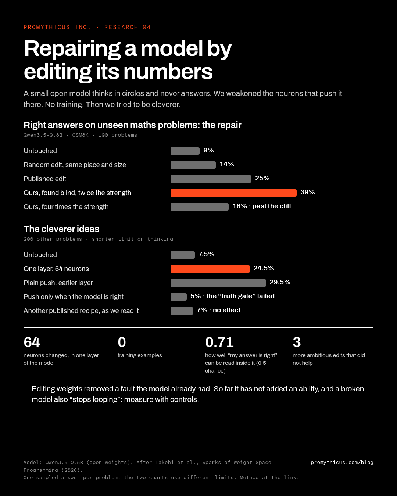

# Repairing a model by editing its weights, and three ideas that failed

**Promythicus research. Author: Bardia Shahrestani.** Write-up for a general reader: [promythicus.com/blog/editing-ai-model-weights-instead-of-fine-tuning/](https://promythicus.com/blog/editing-ai-model-weights-instead-of-fine-tuning/)

**Question.** Can a language model be improved by changing a few of its numbers directly, with no training? How far
does that go?

**Answer.** It can remove a fault. Qwen3.5-0.8B often "thinks" in circles on a maths problem and never answers.
Weakening the 64 neurons in one layer that push hardest toward that state took it from 7.5% to 24.5% right on unseen
GSM8K problems. Three more ambitious edits did not help. Nothing here added an ability the model lacked.

After Takehi, Teoh, Zhang and Khattab, *Sparks of Weight-Space Programming* (2026). Sources and critiques we read are
in `SOURCES.md`.

## Results

The repair (`01-loop-repair/`): 100 unseen problems, thinking cut at 4,096 tokens.

| Model | Right |
| ----- | ----- |
| Untouched | 9% |
| Random direction, same neurons, same strength | 14% |
| The published edit | 25% |
| Ours, found from the model's own behaviour without looking at theirs, same strength | 26% |
| Ours, twice the strength | **39%** |
| Ours, four times the strength | 18% (it stops looping and answers wrong) |

Our direction has cosine 0.70 with the published one, in the same two layers.

The other ideas: 200 other unseen problems, cut at 2,048 tokens (so every number is lower).

| Edit | Right | Folder |
| ---- | ----- | ------ |
| Untouched | 7.5% | |
| Two layers, strength 12 | 19.0% | `03-pathway/` |
| One layer, strength 24 (what a greedy search over layers and strengths settled on) | **24.5%** | `03-pathway/` |
| Plain push at layer 10 | 29.5% | `02-truth/` |
| The same push, gated by a random direction | 21.0% | `02-truth/` |
| The same push, only when a readout says the answer in mind is right | 5.0% | `02-truth/` |
| The mirror image (push only when it says wrong); a lab control | 9.5% | `02-truth/` |
| The AHA recipe as we understood it from its description | 7.0% | `07-aha/` |

- "The answer in mind is right" is readable inside the model (AUC 0.71 on problems the readout was not made from), but
  two hand-written neurons acting on it did worse than a gate that reads nothing.
- Our version of AHA changed nothing at any strength. That is our reading of a blog post failing, not a test of the
  authors' code.

## How

`lib.py` (loading with a patch, sampling, GSM8K grading). Each folder has a `README.md`, its scripts and `out/` with
scores. An edit is a small patch file (which tensor, which neurons, the added values); the base model plus the patch
rebuilds the edited model. Patches themselves are not in the repository; the scripts regenerate them.

## Rules we hold to

Held-out problems for every result; a random edit of the same size in the same place as a control; and, from Kocabay,
*Weight-Space Reading* (2026): an edit that breaks the model is not a result, noise is measured from repeated runs of
the untouched model, and every batch of edits includes some that should do nothing.

## Limits

One small model with one known fault. One sampled answer per problem, so differences of a few points are noise; the
jump from 7.5% to 24.5% is not. The two tables use different limits and problems and cannot be compared.

## Running it

- Everything ran on one workstation with one 16 GB NVIDIA graphics card and no cloud service.
- The larger model is named only as **a mixed-precision variant of Qwen 3.8 27B that runs on a single 16 GB GPU**. Scripts take its file from the environment:
  `export MODEL_GGUF=/path/to/your/model.gguf`. The small models are the public releases.
- Datasets and models are not in this repository; the write-up says where they come from.
- Large raw outputs (model states, patches) are left out; the scripts regenerate them.

## Licence

Code and write-ups: Apache-2.0, copyright 2026 Promythicus Tech Inc. Author: Bardia Shahrestani. Result files that quote dataset text keep the
dataset's licence (CUAD: CC BY 4.0, The Atticus Project).

One run of each, our own scoring: these numbers cannot be set beside published benchmarks. Corrections are welcome:
root@promythicus.com. More experiments: [github.com/Promythicus](https://github.com/Promythicus) ·
[promythicus.com/blog](https://promythicus.com/blog/)
